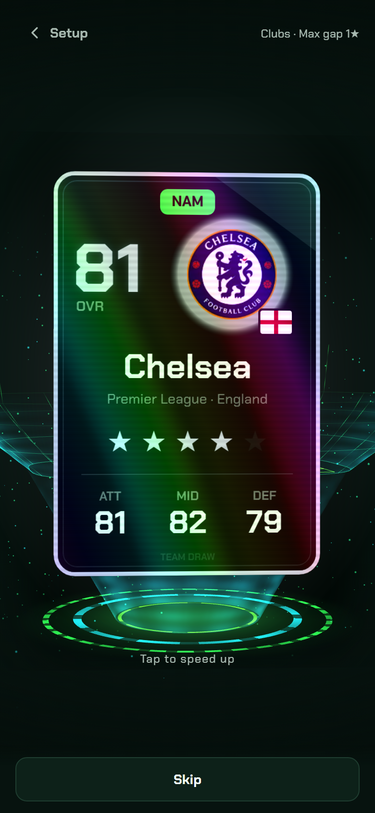
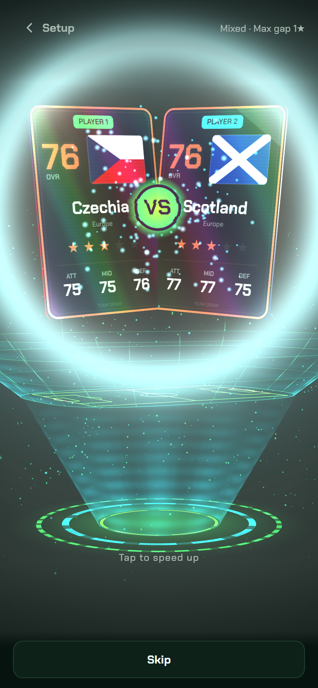
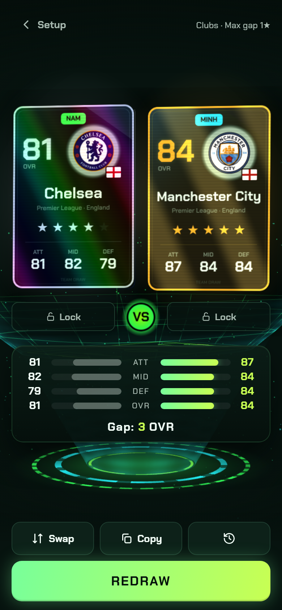

# Team Draw (pespicker)

Web app bốc ngẫu nhiên đội bóng cho trận 1 vs 1 PES 2021 giữa 2 người chơi: chọn mode (National / Clubs / Mixed), chế độ cân bằng, bấm bốc, xem màn reveal 3D hologram rồi vào game chọn đúng đội. Toàn bộ app là một file `dist/index.html` chạy offline.

Màn bốc 3D gồm 3 phần: **Holographic Stadium** (sân vận động hologram dựng lên từ đế chiếu), **3D Team Cards** (card lật 1.5 vòng, foil ánh cầu vồng đổi theo góc nghiêng), **VS Clash** (hai card lao vào nhau, sóng xung kích, chữ VS glitch, thanh so sánh). Màn kết quả: hai card đứng cạnh nhau (P1 trái, P2 phải) để cột trái/phải của thanh so sánh khớp với card, nút khoá và chữ VS nằm ngay dưới card, nền 3D vẫn chuyển động nhẹ. Máy không có WebGL, bật `prefers-reduced-motion` hoặc bật "Reduce effects" thì dùng bản 2D bằng CSS, logic bốc giữ nguyên.

| Card reveal | VS Clash | Kết quả |
|---|---|---|
|  |  |  |

> Trạng thái: Phase 1–4 xong. Deploy (Phase 5) sẽ bổ sung khi làm.

## 1. Yêu cầu môi trường

- Node.js 22 trở lên (khai báo trong `.nvmrc` và `engines` của `package.json`). Dùng nvm: `nvm use`.
- npm 10 trở lên (đi kèm Node).
- Google Chrome cài trên máy (dùng để đọc fifaindex, xem mục 3). Không có Chrome thì script dùng Chromium của Playwright.
- Tài khoản Cloudflare (chỉ cần khi deploy).

## 2. Setup

```bash
git clone <repo-url> pespicker
cd pespicker
npm install
npx playwright install chromium
npm run dev
```

`npm run dev` build vào bộ nhớ, tự reload trình duyệt khi sửa file trong `src/`, và in ra địa chỉ:

```
  Local:   http://localhost:5173/
  LAN:     http://192.168.1.23:5173/   (mở trên điện thoại cùng Wi-Fi)
```

Mở địa chỉ LAN trên điện thoại (cùng mạng Wi-Fi với máy tính). Windows có thể hỏi cho phép Node qua firewall: chọn Private network. Đổi port: `PORT=8080 npm run dev` (PowerShell: `$env:PORT=8080; npm run dev`).

## 3. Cập nhật data

### Nguồn rating

Thứ tự ưu tiên:

1. `src/data/overrides.json`: số nhập tay, luôn thắng.
2. [fifaindex.com](https://fifaindex.com/teams) bản FC 27: OVR / ATK / MID / DEF của CLB và đội tuyển.
3. [eloratings.net](https://eloratings.net) cho 17 tuyển fifaindex không có. Elo được quy đổi sang thang OVR bằng hồi quy tuyến tính trên các tuyển có cả hai nguồn. Đội loại này có `source: "elo-mapped"`, không có ATT/MID/DEF, và hiện nhãn "est." trong app.

Rating EA FC chỉ là proxy để xếp sao, không phải chỉ số PES.

### Thu thập rating

```bash
npm run fetch:ratings
```

- Script mở **một cửa sổ Chrome thật** rồi điều khiển qua CDP. fifaindex (Cloudflare) chặn cả fetch server-side lẫn trình duyệt do Playwright tự launch, còn chế độ headless thì bị dính màn "Just a moment...". Đừng đóng cửa sổ đó khi script đang chạy. Nếu Cloudflare hiện ô xác minh, bấm tay trong cửa sổ, script sẽ chờ tối đa 60s.
- Giới hạn 1 request mỗi 2s. HTML được cache trong `.cache/html/`. Muốn tải lại thì thêm `-- --no-cache`.
- Thử chạy headless (thường bị chặn): `npm run fetch:ratings -- --headless`.
- Đổi FC 27 sang FC 26: sửa `RATINGS_VERSION = 'fc26'` trong `src/config.js`, hoặc chạy một lần với `npm run fetch:ratings -- --version fc26`.
- Chrome nằm ở đường dẫn lạ thì đặt biến môi trường `CHROME_PATH`.
- Kết quả: `src/data/ratings.json` và `DATA_REPORT.md`. Đọc mục "Vấn đề khi thu thập" và "Đội thiếu rating" trong báo cáo.

Tên đội trên mỗi nguồn được match **chính xác** qua `sourceAliases` trong `teams.json` (vd fifaindex gọi AC Milan là `"Milano FC"`, Bayern là `"Bayern München"`; eloratings gọi Côte d'Ivoire là `"Ivory Coast"`). Không match mờ. Đội không khớp sẽ được liệt kê trong báo cáo.

### Tải cờ và logo

```bash
npm run fetch:assets
```

- Cờ lấy từ package `flag-icons`, tối ưu bằng svgo. Cờ có quốc huy chi tiết (> 16 KB) được đổi sang WebP 320×240.
- Logo CLB lấy ảnh đầu bài Wikipedia (`sourceAliases.wikipedia`), tối ưu SVG. SVG còn > 24 KB hoặc gốc là ảnh raster thì đổi sang WebP 128px.
- Nguồn từng logo ghi trong `ASSET_SOURCES.md`. CLB tải lỗi sẽ có `logo: null` và app hiện badge monogram.
- Theo chính sách User-Agent của Wikimedia, script gửi kèm email liên hệ (mặc định `dev@tuhoang.app`, đổi bằng biến môi trường `WIKIMEDIA_CONTACT`). Không có thông tin liên hệ thì Wikimedia giới hạn rất chặt (HTTP 429, chờ 120s mỗi lần). Script vẫn tự chờ và thử lại nếu bị 429.

### Sửa `overrides.json`

Mỗi key là `id` trong `teams.json`. Field nào có mặt sẽ đè lên dữ liệu thu thập, field nào không có thì giữ nguyên. `note` là ghi chú nguồn (tuỳ chọn).

```json
{
  "curacao": { "stars": 2, "note": "theo mod PES" },
  "como": { "ovr": 79, "att": 80, "mid": 78, "def": 77, "note": "số trong mod" }
}
```

- Ví dụ 1: đặt thẳng sao cho một tuyển nhỏ (không cần OVR) → `"curacao": { "stars": 2 }`.
- Ví dụ 2: sửa OVR một CLB → `"como": { "ovr": 79 }`.

Sau khi sửa, chạy `npm run report` để cập nhật `DATA_REPORT.md` mà không cần tải lại gì.

### Nhập CSV khi mọi nguồn đều chặn

Khi fifaindex chặn, `fetch:ratings` tự xuất `ratings_template.csv` (`id,name,ovr,att,mid,def`). Điền số (ô trống được bỏ qua, có thể thêm cột `stars`) rồi:

```bash
npm run import:csv -- ratings_template.csv
```

Dữ liệu CSV được ghi vào `overrides.json`, kèm `note` là tên file và ngày nhập.

### Chỉnh ngưỡng sao

Trong `src/config.js`, `STAR_THRESHOLDS` là 8 mức OVR tối thiểu cho 1.5★ → 5★ (dưới mức đầu là 1★):

```js
//                     1.5★ 2★  2.5★ 3★  3.5★ 4★  4.5★ 5★
export const STAR_THRESHOLDS = [70, 72, 74, 76, 78, 80, 82, 84];
```

Mặc định là dải OVR cố định: mỗi nửa sao = 2 OVR, 5★ = OVR 84 trở lên, nên nhìn OVR là đoán được sao. Không dùng quantile (chia đều số đội vào 9 mức) vì phần lớn đội nằm ở OVR 76–80: chênh 1–2 OVR đã thành 1 sao, dễ gây khó hiểu (vd Algeria 75 bị 1.5★ trong khi Mexico 77 được 2.5★). Bảng "Ngưỡng sao" trong `DATA_REPORT.md` vẫn có hàng quantile để tham khảo. Sửa xong chạy `npm run report` để xem phân bố mới. CLB và tuyển dùng chung một thang. Trong app, nút **Star scale** ở mục Balance hiện bảng OVR của từng mức sao và số đội mỗi mức.

### Thêm hoặc bớt một đội

Sửa `src/data/teams.json`. Field bắt buộc:

| Field | Ý nghĩa |
|---|---|
| `id` | slug duy nhất, chữ thường, gạch ngang (vd `aston-villa`) |
| `name` | tên hiển thị, giữ đúng dấu |
| `sourceAliases` | `{ "fifaindex": tên trên fifaindex hoặc null nếu giống name, "elo": tên trên eloratings hoặc null, "wikipedia": tên bài Wikipedia (CLB) }` |
| `shortName` | viết tắt cho badge monogram |
| `type` | `"national"` hoặc `"club"` |
| `region` | châu lục (đội tuyển), `null` với CLB |
| `country`, `league` | quốc gia, giải đấu (CLB; tuyển để `league: null`) |
| `groups` | nhóm, vd `["Premier League top 5"]` |
| `flagIso` | mã cờ của package flag-icons (`gb-eng`, `gb-sct`...) |
| `logo` | để `null`, `fetch:assets` tự điền đường dẫn (`logos/<id>.svg` hoặc `.webp`) |
| `colors` | `["#màu chính", "#màu phụ"]` |

Sau đó chạy `npm run fetch:ratings` và `npm run fetch:assets`. Logo tự làm tay thì đặt vào `src/assets/logos/<id>.svg` và ghi `logo` tương ứng.

## 4. Build

```bash
npm run build
```

- Output: `dist/index.html`, một file duy nhất. JS, CSS, data JSON, cờ, logo và font Chakra Petch (subset Latin + Latin Extended) đều được nhúng vào.
- Lệnh in kích thước và % ngân sách 3 MB, ví dụ `dist/index.html  420.7 KB  (14% of 3 MB budget)`. Vượt ngân sách thì lệnh trả mã lỗi.
- Kiểm tra chạy offline: tắt mạng, mở thẳng file bằng trình duyệt (kéo `dist/index.html` vào Chrome, hoặc mở `file:///.../dist/index.html`). App phải chạy đủ, không cần server.
- Tự kiểm tra bằng screenshot: `npm run screenshot` chụp các màn ở 390×844 và 360×780 vào `screenshots/`. Script báo lỗi nếu có console error hoặc request mạng nào.
- Xem nhanh toàn bộ cờ và logo: `npm run preview:assets` → `screenshots/assets-preview.png`.
- Đo hiệu năng: `npm run perf` (Playwright + CDP, 390×844, CPU throttle 4x) in fps trung bình, p95 frame time, frame dài nhất của chuỗi Draw đầy đủ và Redraw một bên. `npm run perf -- --swiftshader` đo với GPU phần mềm (kịch bản xấu nhất). Đây chỉ là số tham khảo trên desktop, vẫn phải thử trên điện thoại thật bằng `?debug=1`.

## 5. Deploy Cloudflare Pages

_Phase 5. Project: `pespicker`, domain `pespicker.tuhoang.app`._

## 6. Cấu hình (`src/config.js`)

| Key | Ý nghĩa | Mặc định |
|---|---|---|
| `RATINGS_VERSION` | bản fifaindex cho `fetch:ratings` | `'fc27'` |
| `STAR_THRESHOLDS` | OVR tối thiểu cho 1.5★ → 5★ | `[70, 72, 74, 76, 78, 80, 82, 84]` |
| `SHOW_CLUB_LOGOS` | hiện logo CLB (false = badge monogram) | `true` |
| `DEFAULT_BALANCE` | chế độ cân bằng mặc định | `{ mode: 'gap', gap: 1 }` |
| `HISTORY_LIMIT` | số lượt lịch sử lưu | `20` |

| `TIMING_2D.cardFlip` | thời gian lật một card (ms, animation 2D) | `1100` |
| `TIMING_2D.cardPause` | nghỉ giữa hai card (ms) | `250` |
| `TIMING_2D.vsIn` | chữ VS bật ra (ms) | `450` |
| `TIMING_2D.bars` | thanh so sánh chạy (ms) | `700` |
| `TIMING_2D.speedUp` | tốc độ khi chạm màn hình để tua | `3` |
| `TIMING_3D.boot` | sân hologram dựng lên + camera tiến vào (ms) | `800` |
| `TIMING_3D.cardScan` | card hiện dần từ dưới lên (ms) | `350` |
| `TIMING_3D.cardSpin` | card xoay 1.5 vòng (ms) | `950` |
| `TIMING_3D.cardFlash` | flash vàng cho đội 5★ (ms) | `300` |
| `TIMING_3D.cardSlide` | card thu nhỏ trượt về nửa màn hình (ms) | `450` |
| `TIMING_3D.cardPause` | nghỉ trước card tiếp theo (ms) | `100` |
| `TIMING_3D.clashRush` | hai card lao vào nhau (ms) | `350` |
| `TIMING_3D.clashImpact` | flash + rung khi va chạm (ms, ≤ 150) | `120` |
| `TIMING_3D.clashSeparate` | hai card tách ra (ms) | `450` |
| `TIMING_3D.bars` | thanh so sánh (ms) | `500` |
| `TIMING_3D.speedUp` | tốc độ khi chạm để tua | `3` |
| `QUALITY.high/medium/low` | DPR tối đa, số hạt, antialias của từng tier | high: DPR 2, 900 hạt; medium: 1.5, 500; low: 1, 220 |
| `QUALITY.minFps` / `downgradeAfterMs` | fps dưới ngưỡng này liên tục bao lâu thì hạ 1 tier | `45` / `1500` |

Tổng màn Draw (boot + 2 card + clash) mặc định khoảng 5.9s, nằm trong giới hạn 6s.

## 7. Xử lý sự cố

- **`fetch:ratings` báo bị chặn:** chạy lại (không thêm `--headless`), bấm qua ô xác minh Cloudflare trong cửa sổ Chrome nếu có. Vẫn không được thì dùng CSV (mục 3).
- **`fetch:assets` báo HTTP 429:** Wikimedia đang giới hạn tốc độ. Kiểm tra `WIKIMEDIA_CONTACT` là email thật, chạy lại sau vài phút. File đã tải được cache trong `.cache/assets/`.

- **localStorage bị xoá / chế độ ẩn danh:** app vẫn chạy bằng state trong bộ nhớ, chỉ mất tên người chơi, tuỳ chọn và lịch sử. Không cần làm gì.
- **Logo không hiện:** CLB có `logo: null` trong `teams.json` sẽ hiện badge chữ viết tắt. Chạy lại `npm run fetch:assets`, xem cột lỗi trong `ASSET_SOURCES.md`. Muốn tắt hẳn logo: `SHOW_CLUB_LOGOS = false`.
- **fps thấp trên điện thoại:** mở app với `?debug=1` (vd `http://192.168.1.23:5173/?debug=1`) để xem HUD: fps, frame time, draw call, triangle, tier, DPR. App tự hạ tier (DPR 2 → 1.5 → 1, giảm số hạt) khi fps < 45 liên tục 1.5s và nhớ tier vào localStorage (`pespicker:tier`). Muốn ép tier: chạy `__scene.setTier('low')` trong console khi có `?debug=1`. Vẫn giật thì bật "Reduce effects" (dùng bản 2D).
- **WebGL không chạy:** app tự chuyển sang bản 2D (CSS), không cần làm gì. Muốn thử bản 2D trên máy có WebGL: thêm `?no3d` vào URL. Mất WebGL giữa chừng (`webglcontextlost`) thì lượt đang chạy nhảy thẳng tới kết quả và các lượt sau dùng 2D cho tới khi context được khôi phục.
- **Animation giật trên máy yếu:** bật "Reduce effects" ở màn Setup.

_Mục lỗi xác thực wrangler sẽ bổ sung ở Phase 5._

## 8. Lệnh npm

| Lệnh | Việc |
|---|---|
| `npm run fetch:ratings` | thu thập rating, cập nhật `ratings.json` và `DATA_REPORT.md` |
| `npm run fetch:assets` | tải và tối ưu cờ, logo |
| `npm run import:csv -- <file>` | nạp rating tay từ CSV |
| `npm run report` | sinh lại `DATA_REPORT.md` từ data hiện có |
| `npm test` | unit test logic bốc |
| `npm run dev` | server local có live reload, in IP LAN |
| `npm run build` | ra `dist/index.html`, in kích thước file |
| `npm run screenshot` | chụp screenshot tự kiểm tra (390×844, 360×780) |
| `npm run preview:assets` | ảnh tổng hợp cờ và logo |
| `npm run perf` | đo fps, p95, frame dài nhất (CPU throttle 4x) |
| `npm run deploy` | build rồi `wrangler pages deploy dist` (Phase 5) |
